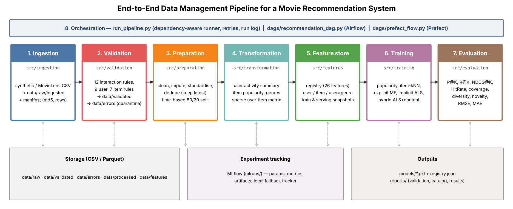

# End-to-End Data Management Pipeline for a Recommendation System

*Data Management for Machine Learning: Assignment 2*

This project is a modular, reproducible pipeline for a **movie recommendation platform**. It runs
these stages in order: ingestion, validation, preparation, transformation, feature store, training,
evaluation. A single command runs the whole thing (about 30 seconds on a laptop), and the same
task graph is also provided as an **Apache Airflow DAG** and a **Prefect flow**.



## Results (K = 10, time-based test split)

| Model | Precision@10 | Recall@10 | NDCG@10 | HitRate@10 | Coverage | Diversity | RMSE | MAE |
|---|---:|---:|---:|---:|---:|---:|---:|---:|
| Popularity (baseline) | 0.0730 | 0.1635 | 0.1403 | 0.4837 | 0.087 | 0.899 | 0.802 | 0.637 |
| Item-kNN CF | 0.0732 | 0.1608 | 0.1401 | 0.4799 | 0.113 | 0.897 | 0.829 | 0.657 |
| Explicit MF (SGD) | 0.0237 | 0.0497 | 0.0366 | 0.1935 | 0.122 | 0.863 | **0.693** | **0.553** |
| Implicit ALS | 0.0995 | 0.2287 | 0.1955 | 0.5678 | 0.505 | 0.845 | 0.896 | 0.697 |
| **Hybrid (ALS + content + popularity)** | **0.1222** | **0.2778** | **0.2390** | **0.6281** | **0.597** | 0.649 | **0.693** | **0.553** |

Full table: `reports/model_comparison.md`. Chart: `reports/figures/model_comparison.png`.
The hybrid model improves NDCG@10 by **70%** over the popularity baseline and covers 7× more of the catalogue.

## Quick start

```bash
git clone <your-repo-url> recommendation-pipeline && cd recommendation-pipeline
python -m venv .venv && source .venv/bin/activate        # Windows: .venv\Scripts\activate
pip install -r requirements.txt

python run_pipeline.py                 # run all 8 tasks end-to-end
python -m pytest -q                    # 7 unit tests (metrics, validation rules, preparation)
python -m src.predict --users U00001 U00042 --k 10      # serve recommendations
python -m src.training.tune            # optional: hyper-parameter search on a validation slice
mlflow ui --backend-store-uri sqlite:///mlflow.db   # browse experiments at http://127.0.0.1:5000
```

Useful options:

```bash
python run_pipeline.py --only train_models evaluate_models   # re-run a subset of tasks
python run_pipeline.py --retries 2 --config configs/config.yaml
```

Each run writes `reports/runs/run_<id>.json` (task status, timings, errors) and
`reports/runs/latest_run.png` (status-coloured DAG plus a Gantt timeline).

### Orchestrators

| Option | File | How to run |
|---|---|---|
| Built-in runner (default) | `src/orchestration/pipeline.py`, `run_pipeline.py` | `python run_pipeline.py`; schedule with cron: `0 2 * * * cd <repo> && .venv/bin/python run_pipeline.py` |
| Apache Airflow 2.x | `dags/recommendation_dag.py` | `export RECSYS_HOME=$PWD; cp dags/recommendation_dag.py $AIRFLOW_HOME/dags/; airflow standalone`, then trigger `recommendation_pipeline` |
| Prefect 2/3 | `dags/prefect_flow.py` | `pip install prefect && python dags/prefect_flow.py` (`--serve` for a daily schedule) |

All three call the same stage functions with the same dependencies:

```
ingest_data → validate_data → prepare_data ─┬─> transform_data ─┐
                                            ├─> build_features ─┴─> train_models → evaluate_models
                                            └─> build_serving_features
```

## Dataset

The pipeline uses a documented **synthetic movie-platform dataset**: 1,000 users, 600 movies,
12 genres and about 59.9k ratings from 2023 to 2026. About 2% of records are deliberately corrupted
so that validation has real work to do. See [`docs/synthetic_data.md`](docs/synthetic_data.md).
The generated CSVs are in `data/raw/source/`. To use MovieLens instead, put `ml-latest-small/`
in `data/external/` and set `ingestion.source: movielens`.

## Project structure

```
recommendation-pipeline/
├── configs/config.yaml            # every path, threshold and hyper-parameter, plus the seed
├── data/
│   ├── raw/source/                # generated / downloaded data (as delivered)
│   ├── raw/ingested/              # bronze copy + lineage columns
│   ├── validated/                 # records that passed validation
│   ├── errors/                    # *_errors.csv (quarantined) and *_warnings.csv
│   ├── processed/                 # clean tables, train/test, derived datasets, sparse matrix
│   └── features/                  # feature store snapshots (training) and features/serving/
├── src/
│   ├── ingestion/                 # generate_synthetic.py, ingest.py
│   ├── validation/                # rules.py (declarative rules), validate.py
│   ├── preparation/               # prepare.py (clean, impute, dedupe, time split)
│   ├── transformation/            # transform.py (summaries, popularity, interaction matrix)
│   ├── features/                  # registry.py (feature definitions), build_features.py (store)
│   ├── training/                  # models.py, train.py, tracking.py (MLflow), tune.py
│   ├── evaluation/                # metrics.py, evaluate.py
│   ├── orchestration/             # pipeline.py (DAG + runner), render.py
│   └── predict.py                 # serving / inference CLI
├── dags/                          # Airflow DAG and Prefect flow
├── models/                        # *.pkl + registry.json (run_id ↔ artifact)
├── mlruns/                        # experiment tracking store
├── reports/                       # validation report, feature catalog, results, run logs
├── docs/                          # architecture diagram, dataset docs, final report
├── tests/
├── run_pipeline.py
└── requirements.txt
```

## Stage details

1. **Ingestion** (`src/ingestion`). Reads every column as a string so nothing is silently coerced.
   It checks the schema, adds `_source_file` and `_ingested_at` lineage columns, and writes a manifest
   with row counts and MD5 checksums.
2. **Validation** (`src/validation`). Declarative rules with two severities. *Errors* (missing keys,
   non-numeric or out-of-range ratings, unparseable, future or too-old timestamps, orphan user or
   item IDs, duplicates) are quarantined to `data/errors/` with an `error_reason` column. *Warnings*
   (missing or impossible age, bad dates, inconsistent labels) are kept and fixed in preparation.
   Users and items are validated first, so referential integrity checks against *valid* IDs only.
   Output: `reports/validation_report.md`.
3. **Preparation** (`src/preparation`). Standardises gender, country and genre case; imputes
   missing values (with an `age_imputed` flag); keeps the latest rating when a user re-rates a movie;
   and splits the data by time (the most recent 20% of ratings form the test set). This avoids
   leaking future behaviour into training.
4. **Transformation** (`src/transformation`). Builds `user_activity_summary`, `item_popularity`,
   `genre_summary` and a sparse CSR user-item matrix with its index files, from the train split only.
5. **Feature management** (`src/features`). `registry.py` declares 26 features: 12 user, 11 item and
   3 user×genre. `compute_features()` is a pure function used for both the training snapshot
   (as_of = split cutoff) and the serving snapshot (as_of = latest data). `FeatureStore` gives lookup
   access. The catalog is generated automatically: `reports/feature_catalog.md`.
6. **Training** (`src/training`). Five models share one interface. Parameters, metrics, the model
   pickle and the config are logged to MLflow (SQLite backend `mlflow.db`, artifacts in `mlruns/`),
   or to an MLflow-like local tracker if MLflow is not installed or fails to start. Hyper-parameters were tuned on a validation slice of the *training* period
   (`reports/tuning_results.csv`), never on the test set.
7. **Evaluation** (`src/evaluation`). Precision, Recall, NDCG and HitRate @K, catalogue coverage,
   intra-list genre diversity, novelty, and RMSE/MAE. Metrics are logged back to each model's
   training run.

## Deliverables checklist

| Deliverable | Location |
|---|---|
| Source code organised into modules | `src/`, `dags/`, `run_pipeline.py` |
| README with setup and run instructions | this file |
| requirements.txt | `requirements.txt` |
| Architecture diagram | `docs/architecture.png` (source: `docs/make_architecture.py`) |
| Data validation report and logs | `reports/validation_report.md`, `data/errors/`, `logs/pipeline.log` |
| Feature catalog | `reports/feature_catalog.md` (and `.csv`) |
| Model evaluation results | `reports/model_comparison.md`, `reports/figures/model_comparison.png` |
| Orchestration DAG and a successful run | `dags/recommendation_dag.py`, `dags/prefect_flow.py`, `reports/runs/latest_run.png` |
| Final report | `docs/final_report.pdf` |

> **Screenshot note:** `reports/runs/latest_run.png` is rendered from the built-in runner's run
> record. If your marker expects an Airflow UI screenshot, run the DAG with
> `airflow standalone` and capture the Graph view (see `dags/recommendation_dag.py`).
