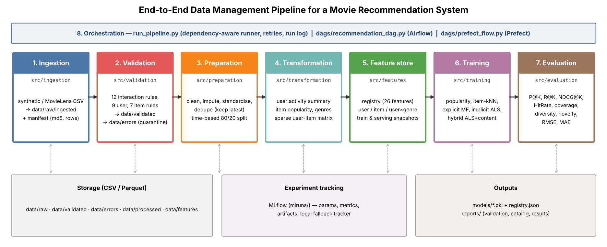
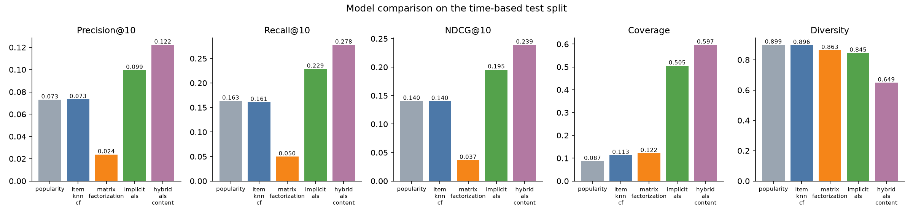

# 1. Objective and scope

The goal was a clean, modular and reproducible pipeline that takes raw user, item and rating data
through to evaluated recommendation models. The domain is a movie-streaming platform. The pipeline
has eight orchestrated tasks (ingest, validate, prepare, transform, build training features, build
serving features, train, evaluate). Every path, threshold, hyper-parameter and the random seed live
in a single file, `configs/config.yaml`. A full run takes about 30 seconds.

{width=100%}

# 2. Design decisions

**Data source.** I used a documented synthetic dataset (1,000 users, 600 movies, 12 genres, about
59.9k ratings, 2023–2026) instead of a public one, for two reasons. First, its generative process
is known: choices depend on popularity × exp(6 × genre-taste match), and ratings depend on quality,
user bias and taste. That makes it possible to check whether the models recover real signal.
Second, about 2% of every table is deliberately corrupted (bad ratings, broken or future
timestamps, orphan IDs, duplicates, inconsistent labels), which gives the validation layer real
work. The same seed reproduces byte-identical files, with MD5 checksums in the ingestion manifest.
A MovieLens loader is included as an alternative source.

**Ingestion as a "dumb" bronze layer.** Every column is read as a string, so no value is coerced
or lost before validation. Lineage columns and a manifest (row counts, checksums) are added.

**Two-severity validation.** I wrote 28 declarative rules (`src/validation/rules.py`). Each rule
returns a boolean mask of failing rows, so rules are easy to test and extend. **Errors** are
quarantined to `data/errors/*_errors.csv` with an `error_reason` column. **Warnings** are repairable
issues: they are kept, logged to `*_warnings.csv`, and fixed in preparation. Users and items are
validated before interactions, so referential integrity is checked against *valid* IDs only.
Result: 3,210 of 59,891 interaction rows (5.4%) were quarantined; users and items passed at 99.0%.
A single row can fail several rules, such as a non-numeric rating combined with a bad timestamp.

**Preparation and time-based split.** Cleaning standardises labels, imputes values (with an
`age_imputed` flag) and resolves repeat ratings by keeping the latest one. The split is a
**global temporal cutoff**: the most recent 20% of ratings, after 2026-05-21, form the test set.
A random split would let models learn from the future. All derived datasets (user activity
summary, item popularity, genre summary, sparse user-item matrix with 7.5% density) and all
features are computed from the training period only.

**Custom feature store.** Feast would be heavy for a single machine, so I built a small feature
layer. `registry.py` declares 26 features (user, item and user×genre), each with its type,
description, logic and source. A single pure function, `compute_features(data, as_of)`, produces a
point-in-time **training** snapshot (as_of = cutoff) and a **serving** snapshot (as_of = latest
data). Because both use the same code, there is no training/serving skew. The feature catalog is
generated from the registry, so documentation cannot drift from the code.

**Models.** All five models share one interface (`fit`, `score_all`, `recommend`, `predict`):

* *Popularity baseline*: time-decayed rating counts (180-day half-life, at least 5 ratings).
* *Item-kNN CF*: cosine similarity on co-occurrence, with shrinkage and the top 100 neighbours.
* *Explicit MF*: biased Funk-SVD trained by SGD, used to predict ratings for RMSE and MAE.
* *Implicit ALS* (Hu, Koren & Volinsky): confidence-weighted factorisation that predicts
  *engagement*.
* *Hybrid*: a z-scored blend of ALS (0.6), content genre affinity from the feature store (0.3) and
  popularity (0.1).

Hyper-parameters for ALS and kNN were grid-searched on the last 20% of the *training* period, so
the test set stays untouched.

**Tracking and orchestration.** Runs log their parameters, metrics, model pickle and config to
MLflow. A drop-in local tracker with the same layout is used if MLflow is not installed. A model
registry file links each artifact to its run, and evaluation metrics are written back to the same
run. The task graph is defined once and executed by a built-in dependency-aware runner
(topological order, retries, upstream-failure propagation, a JSON run record and a rendered run
graph). The same graph is also provided as an Airflow DAG and a Prefect flow. Stages communicate
through files rather than in-memory objects, so each task is idempotent and can be re-run on its own.

# 3. Results

Evaluation uses K = 10. A test rating of 4 or more counts as relevant; 796 users had at least one
relevant item (4.81 on average). Items the user rated in the training period are excluded from
their recommendations.

| Model | P@10 | R@10 | NDCG@10 | Hit@10 | Coverage | Diversity | RMSE | MAE |
|---|---:|---:|---:|---:|---:|---:|---:|---:|
| Popularity (baseline) | 0.073 | 0.164 | 0.140 | 0.484 | 0.087 | 0.899 | 0.802 | 0.637 |
| Item-kNN CF | 0.073 | 0.161 | 0.140 | 0.480 | 0.113 | 0.897 | 0.829 | 0.657 |
| Explicit MF | 0.024 | 0.050 | 0.037 | 0.194 | 0.122 | 0.863 | **0.693** | **0.553** |
| Implicit ALS | 0.100 | 0.229 | 0.196 | 0.568 | 0.505 | 0.845 | 0.896 | 0.697 |
| **Hybrid** | **0.122** | **0.278** | **0.239** | **0.628** | **0.597** | 0.649 | **0.693** | **0.553** |

{width=100%}

**Key findings.**

1. The hybrid model is best on every accuracy metric. It reaches NDCG@10 of 0.239 against 0.140 for
   the baseline (+70%), recommends at least one liked movie to 63% of users (baseline: 48%), and
   covers 60% of the catalogue (baseline: 9%).
2. **Predicting ratings is not the same as ranking.** Explicit MF has the best RMSE but the worst
   top-N accuracy. It rates obscure, niche movies highly while ignoring what users actually choose to
   watch. Implicit ALS models *selection* and ranks much better. The hybrid therefore uses ALS for
   ranking and MF for rating prediction.
3. Popularity is a strong baseline, which matches reports on public datasets such as MovieLens, and
   item-kNN only matches it. Adding the feature-store genre affinity to ALS gives a further 22% gain
   in NDCG.
4. There is an **accuracy–diversity trade-off.** The hybrid's genre-affinity term pulls each list
   towards a user's favourite genres, so intra-list diversity falls from about 0.85 to 0.65 while
   novelty rises. A re-ranking step such as MMR could recover diversity if the product needs it.

# 4. Limitations and future work

* **Synthetic data.** Absolute metric values depend on the generator, so the relative conclusions
  should be confirmed on MovieLens (`ingestion.source: movielens`).
* **Scale.** The pipeline runs in memory with pandas and dense score matrices, which is fine for
  this dataset size (about 10⁵ ratings). Larger data would need Spark or Polars, approximate
  nearest-neighbour retrieval and the `implicit` library.
* **Cold start.** Unknown users fall back to popularity, and items with no training history cannot
  be recommended by the collaborative models. Content features could be used to bootstrap new items.
* **Validation tooling.** The custom rules could be moved to Great Expectations or Pandera to get
  data docs. Distribution-drift checks between runs are not yet implemented.
* **Single temporal split.** A rolling-origin evaluation would give confidence intervals. The
  hybrid weights were set by hand rather than tuned.
* **Orchestration evidence.** The run screenshot comes from the built-in runner. The Airflow and
  Prefect definitions use the same tasks but were not run in the development environment.
